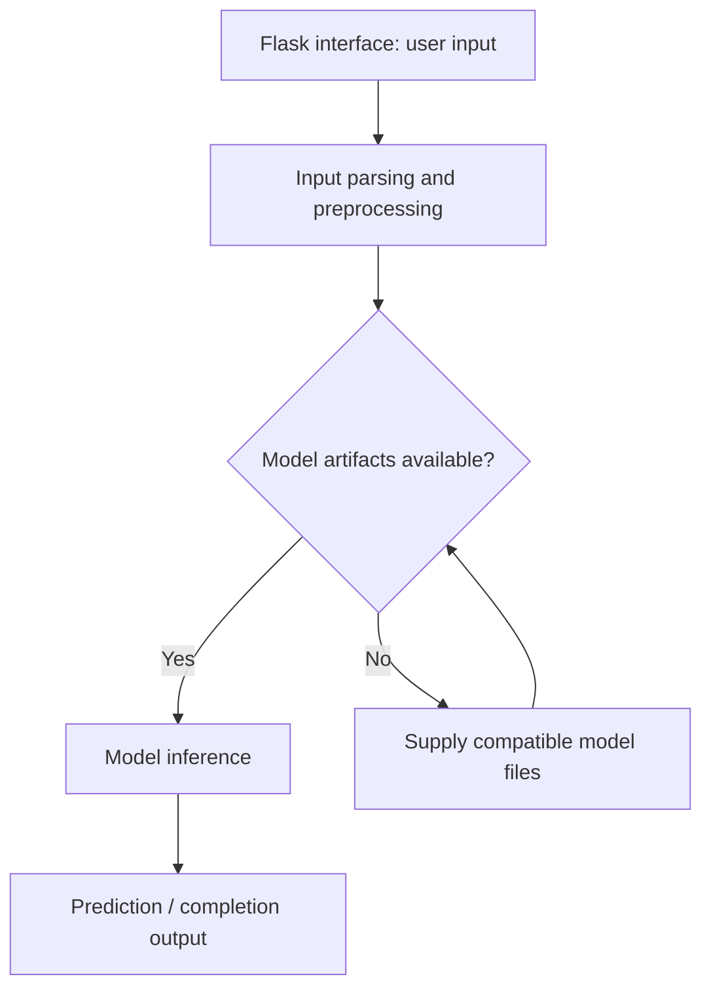

# Breast Histopathology Classification — Deep Learning

Educational breast-histopathology image-classification project with a training notebook, saved-model integration, a Flask interface, and project reports.

## Project focus

Machine-learning experiment. Use the directory map to choose a focused example or learning topic instead of treating the repository as one application.

## Workflow



## Repository structure

| Path | Purpose |
| --- | --- |
| [`Breast_Cancer_Detection_Project_Report.docx`](Breast_Cancer_Detection_Project_Report.docx) | Project-specific source, resources, or learning material. |
| [`Media/`](Media) | Project-specific source, resources, or learning material. |
| [`Project Report.docx`](Project%20Report.docx) | Project-specific source, resources, or learning material. |
| [`Project Report.pdf`](Project%20Report.pdf) | Project-specific source, resources, or learning material. |
| [`breast_cancer_colab_training.ipynb`](breast_cancer_colab_training.ipynb) | Interactive notebook; inspect its data and dependency setup before execution. |
| [`flask_app/`](flask_app) | Image-classification web application. |
| [`requirements.ps1`](requirements.ps1) | Dependencies for the named execution environment. |
| [`requirements.txt`](requirements.txt) | Python dependency manifest. |

## Getting started

```bash
git clone https://github.com/Raimal-Raja/Breast_Cancer_Detection_using_imageDatates_DeepLearning.git
cd Breast_Cancer_Detection_using_imageDatates_DeepLearning
```

```bash
python -m venv .venv
source .venv/bin/activate
```

On Windows PowerShell, activate the environment with `.venv\Scripts\Activate.ps1` instead.

```bash
python -m pip install -r requirements.txt
```

```bash
cd flask_app
python app.py
```

## Configuration and scope

Use the Python version and TensorFlow-compatible NumPy versions declared by the existing requirements (Python 3.10 is documented for this project). Supply the model files expected by `flask_app/app.py`. This is an educational research prototype, not a clinically validated diagnostic system. Historical training scores are not new validation results.

## Verification

Use the setup commands and inspect the selected interface, example, or notebook with known inputs. This documentation review checks repository paths and dependency declarations; it does not claim fresh end-to-end execution or model-quality measurements.

## Contributing

Include reproduction steps, the affected path, expected behavior, and the checks you ran. Keep credentials, generated environments, and unnecessary build artifacts out of commits.

## License

No top-level license file is currently tracked. Check reuse permissions with the repository owner.
